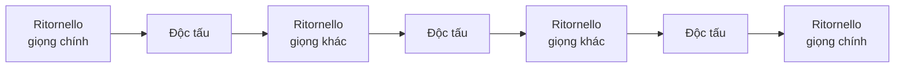

# Concerto và ritornello

**Concerto** là tác phẩm cho **một (hoặc vài) nhạc cụ độc tấu** cùng dàn nhạc. Sức hấp dẫn của nó nằm ở cuộc "đối thoại", có khi là "tranh tài", giữa một người và số đông.

## Concerto thời Baroque: hình thức ritornello

Vivaldi và Bach dùng hình thức **ritornello** (tiếng Ý: "điệp khúc nhỏ"):

- **Ritornello** do **cả dàn nhạc** (*tutti*) chơi, mở đầu và kết thúc chương, và quay lại nhiều lần ở giữa, thường **ở các giọng khác nhau** và có khi chỉ một đoạn ngắn.
- Xen giữa là các **đoạn độc tấu** (*solo*): nhạc cụ độc tấu khoe kỹ thuật, chuyển giọng.



Khác với rondo, ritornello quay lại ở **giọng khác nhau** và thường **bị rút ngắn**; nó vừa là điệp khúc, vừa là "cột mốc" chuyển giọng.

Ngoài ra còn **concerto grosso**: một nhóm nhỏ nhạc cụ độc tấu (*concertino*) đối đáp với cả dàn nhạc (*ripieno*), như các concerto Op. 6 của Corelli và Handel.

**Đi qua một tác phẩm:** [Vivaldi *Mùa xuân*, chương 1](../nghe-nhac/vivaldi-mua-xuan.md) là ví dụ mẫu mực, có hướng dẫn nghe chi tiết.

## Concerto thời Cổ điển và Lãng mạn

Từ Mozart, concerto thường có **3 chương: nhanh – chậm – nhanh**.

- **Chương 1** kết hợp hình thức sonata với ý tưởng ritornello: thường có một phần trình bày của **dàn nhạc** trước, rồi một phần trình bày của **nghệ sĩ độc tấu**.
- **Cadenza**: gần cuối chương 1, dàn nhạc dừng lại trên một hợp âm, nghệ sĩ độc tấu chơi một mình một đoạn tự do, khoe kỹ thuật và tưởng tượng, rồi dàn nhạc vào lại để kết. Thời Mozart, cadenza thường được **ứng tác**; từ Beethoven, nhà soạn nhạc viết sẵn ngày càng nhiều.
- **Chương 2**: chậm, trữ tình, như một aria không lời.
- **Chương 3**: nhanh, thường là rondo.

Thời Lãng mạn, nhà soạn nhạc phá dần khuôn mẫu: Mendelssohn cho violin vào ngay từ ô nhịp thứ hai và nối các chương liền nhau; Rachmaninoff mở đầu Concerto số 2 bằng piano độc tấu.

## Nghe thêm

| Tác phẩm | Điều cần nghe | Hướng dẫn |
|---|---|---|
| Vivaldi *Bốn Mùa* | Ritornello, âm nhạc miêu tả | [Mùa xuân](../nghe-nhac/vivaldi-mua-xuan.md) |
| Bach *Brandenburg Concerto* số 5, chương 1 | Harpsichord, vốn chỉ đệm, bỗng có một cadenza dài | |
| Mendelssohn Concerto violin | Cadenza đặt trước tái hiện; các chương nối liền | [Hướng dẫn](../nghe-nhac/mendelssohn-violin.md) |
| Rachmaninoff Concerto piano số 2 | Mở đầu bằng 8 hợp âm piano như tiếng chuông | [Hướng dẫn](../nghe-nhac/rachmaninoff-2.md) |
| Rodrigo *Concierto de Aranjuez*, chương 2 | Guitar và kèn cor anglais đối đáp | |

```quiz
? Trong concerto Baroque, ritornello do ai chơi?
+ Cả dàn nhạc
- Nhạc cụ độc tấu
- Chỉ harpsichord
> Tutti; các đoạn xen giữa là độc tấu.
? Cadenza là gì?
+ Đoạn độc tấu tự do khi dàn nhạc dừng lại
- Chương chậm của concerto
- Đoạn dàn nhạc chơi một mình
> Thời Mozart thường được ứng tác.
? Concerto Cổ điển thường có bao nhiêu chương?
- 2
+ 3
- 4
> Nhanh – chậm – nhanh.
```

## Nguồn

- [Open Music Theory](https://viva.pressbooks.pub/openmusictheory/), phần hình thức.
- Ví dụ tác phẩm đối chiếu với bản nhạc trên [IMSLP](https://imslp.org/). Xem [tài liệu tham khảo](../tai-lieu-tham-khao.md).
