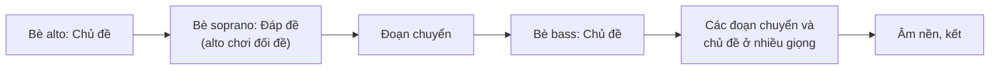

# Fugue

**Fugue** là hình thức phức điệu đỉnh cao của thời Baroque: nhiều bè độc lập lần lượt "đuổi theo" nhau bằng cùng một chủ đề. Tên gọi từ tiếng Latin *fuga*, nghĩa là "chạy trốn".

## Các thành phần

| Thành phần | Là gì |
|---|---|
| **Số bè** | Thường 3 hoặc 4 bè (soprano, alto, tenor, bass), kể cả khi chơi trên một cây đàn phím |
| **Chủ đề** (subject) | Giai điệu chính, ngắn, dễ nhận ra, xuất hiện đầu tiên ở một bè **đơn độc** |
| **Đáp đề** (answer) | Chủ đề được nhắc lại ở bè thứ hai, cao hơn một quãng 5 hoặc thấp hơn một quãng 4 (tức ở giọng át) |
| **Đối đề** (countersubject) | Giai điệu đi kèm, bè trước chơi trong lúc bè sau vào chủ đề; thường quay lại nhiều lần |
| **Phần trình bày** | Đoạn đầu, khi mọi bè lần lượt vào với chủ đề hoặc đáp đề |
| **Đoạn chuyển** (episode) | Đoạn không có chủ đề trọn vẹn, thường dùng mảnh của chủ đề để chuyển sang giọng khác |
| **Stretto** | Các bè vào chủ đề **chồng lấn** nhau trước khi bè trước kết thúc, tạo cao trào |
| **Âm nền** (pedal point) | Một nốt giữ dài ở bè trầm, thường gần cuối (xem [bài 18](../nhac-ly/18-am-ngoai-hop-am.md)) |



## Đi qua một tác phẩm: Bach Fugue cung Đô thứ, BWV 847

Fugue số 2 trong *Bình quân luật* quyển 1 (1722) có **3 bè** và chỉ dài **31 ô nhịp**, khoảng 1,5 phút. Đây là fugue tốt nhất để bắt đầu: chủ đề rất dễ nhận ra, nhịp nhanh và rõ.

| Ô nhịp (khoảng) | Điều xảy ra |
|---|---|
| 1–2 | **Bè alto** (giữa) chơi chủ đề một mình: một giai điệu ngắn, nhảy nhót, ở Đô thứ |
| 3–4 | **Bè soprano** (cao) vào **đáp đề** ở Sol thứ; bè alto chơi **đối đề** bên dưới |
| 5–6 | **Đoạn chuyển** ngắn, chưa có bè thứ ba |
| 7–8 | **Bè bass** (thấp) vào chủ đề ở Đô thứ: kết thúc phần trình bày |
| 9–25 | Xen kẽ đoạn chuyển và chủ đề ở các giọng gần: Mi♭ trưởng (ô 11), Sol thứ (ô 15), Đô thứ (ô 20) |
| 26–31 | Bè bass vào chủ đề lần cuối (ô 26); từ giữa ô 29, một **âm nền** Đô ngân ở bè trầm dưới lần vào cuối của soprano; fugue kết thúc ở hợp âm **Đô trưởng** dù cả bài ở Đô thứ |

Hợp âm trưởng ở cuối một bài giọng thứ có tên riêng: **quãng 3 Picardy** (*tierce de Picardie*), rất phổ biến trong nhạc Baroque.

**Cách nghe:** lần đầu, chỉ đếm số lần chủ đề xuất hiện. Lần sau, đoán xem chủ đề đang ở bè nào: cao, giữa hay thấp. Nghe kèm video có bản nhạc chạy theo (tìm *"BWV 847 score"*) sẽ dễ hơn nhiều. Muốn tự chơi bài này, xem [bài học Prelude và fugue Đô thứ](../piano/tac-pham/bach-prelude-fugue-do-thu.md).

## Nghe thêm

- Bach *Fugue cung Sol thứ*, BWV 578 ("Little Fugue") cho organ: 4 bè, chủ đề dài và hát được.
- Bach *Nghệ thuật Fugue* (*Die Kunst der Fuge*, BWV 1080): cả một tập fugue trên cùng một chủ đề, dang dở ở fugue cuối cùng.
- Mozart, chương cuối Giao hưởng số 41 *Jupiter*: kỹ thuật fugue trong một chương hình thức sonata.
- Britten *The Young Person's Guide to the Orchestra*: kết thúc bằng một fugue mà từng nhạc cụ lần lượt vào (xem [Dàn nhạc giao hưởng](../nhac-cu/dan-nhac.md)).

```quiz
? Bè thứ hai vào trong fugue thường chơi gì?
+ Đáp đề, chủ đề ở giọng át
- Một giai điệu hoàn toàn mới
- Chủ đề ngược
> Cao hơn một quãng 5 hoặc thấp hơn một quãng 4.
? Stretto là gì?
+ Các bè vào chủ đề chồng lấn nhau
- Đoạn không có chủ đề
- Nốt giữ dài ở bè trầm
> Thường tạo cao trào gần cuối.
? Fugue BWV 847 có bao nhiêu bè?
- 2
+ 3
- 4
> Alto, soprano rồi bass lần lượt vào.
? Kết một bài giọng thứ bằng hợp âm trưởng gọi là gì?
+ Quãng 3 Picardy
- Kết lừa
- Kết plagal
> Tierce de Picardie.
```

## Nguồn

- [Open Music Theory](https://viva.pressbooks.pub/openmusictheory/), phần hình thức.
- Ví dụ tác phẩm đối chiếu với bản nhạc trên [IMSLP](https://imslp.org/). Xem [tài liệu tham khảo](../tai-lieu-tham-khao.md).
