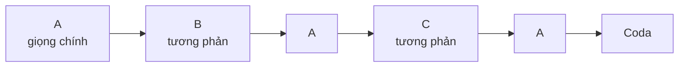

# Rondo

**Rondo** là hình thức có một đoạn chính (A) **quay lại nhiều lần**, xen giữa là các đoạn tương phản: **A – B – A – C – A**, có khi dài hơn. Đoạn A quay về giống như điệp khúc của một bài hát, nên rondo dễ nghe và thường vui tươi. Nó hay dùng cho **chương cuối** của sonata, concerto và giao hưởng thời Cổ điển.



## Đi qua một tác phẩm: Beethoven, Für Elise (WoO 59)

*Bagatelle cung La thứ*, khoảng 1810, xuất bản sau khi Beethoven mất. Bản nhạc ngắn (khoảng 3 phút) nhưng có đầy đủ hình thức rondo.

| Phần | Giọng | Điều cần nghe |
|---|---|---|
| **A** | La thứ | Giai điệu quen thuộc: Mi – Rê♯ – Mi – Rê♯… (xem [10 bài đầu tiên cho piano](../nhac-cu/piano.md)) |
| **B** | Fa trưởng, rồi Đô trưởng | Sáng hơn, trữ tình, rồi chuỗi nốt nhanh đi xuống |
| **A** | La thứ | Giai điệu chính trở lại, nguyên vẹn |
| **C** | Rê thứ, trên **âm nền La** ở bè trầm | Nốt La lặp lại dồn dập ở tay trái; căng thẳng, kịch tính nhất bài |
| **A** | La thứ | Trở lại lần cuối, kết thúc nhẹ nhàng |

**Cách nghe:** mỗi khi giai điệu "Mi – Rê♯" quay lại, giơ một ngón tay. Bạn sẽ đếm được ba lần A.

## Nghe thêm

- Mozart, chương 3 Sonata piano K. 331, *Rondo alla Turca*: mô phỏng âm nhạc quân đội Ottoman, rất phổ biến ở Vienna thời đó.
- Chương cuối của nhiều concerto Mozart và Beethoven: thường là rondo hoặc sonata – rondo.
- [Vivaldi *Mùa xuân*](../nghe-nhac/vivaldi-mua-xuan.md): hình thức ritornello của concerto Baroque cũng dựa trên ý tưởng "một đoạn quay lại nhiều lần", nhưng mỗi lần ở giọng khác, xem [Concerto và ritornello](concerto.md).

```quiz
? Sơ đồ của rondo năm đoạn là gì?
+ A – B – A – C – A
- A – B – A
- A – A' – A'' – A'''
> A – B – A là hình thức ba đoạn; A – A' – A'' là biến tấu.
? Rondo thường dùng cho chương nào?
- Chương đầu
- Chương chậm
+ Chương cuối
> Vì tính chất vui tươi, dễ nhớ.
? Đoạn C của Für Elise có gì đặc biệt?
+ Nốt La lặp lại dồn dập ở bè trầm (âm nền)
- Chuyển sang nhịp 3/4
- Chơi chậm hơn hẳn
> Đó là đoạn căng thẳng nhất bài.
```

## Nguồn

- [Open Music Theory](https://viva.pressbooks.pub/openmusictheory/), phần hình thức.
- Ví dụ tác phẩm đối chiếu với bản nhạc trên [IMSLP](https://imslp.org/). Xem [tài liệu tham khảo](../tai-lieu-tham-khao.md).
