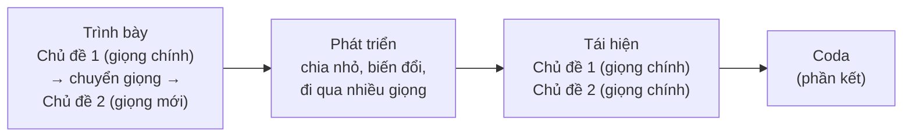

# Hình thức sonata

Hình thức sonata là "kiến trúc" quan trọng nhất của nhạc thời Cổ điển và Lãng mạn. Nó thường dùng cho **chương đầu** của giao hưởng, sonata, concerto, tứ tấu. Hiểu nó rồi, bạn có thể theo dõi gần như mọi bản giao hưởng từ Haydn đến Brahms.

## Ý tưởng cốt lõi: một xung đột giữa hai giọng

Hình thức sonata giống một vở kịch ba hồi:



1. **Trình bày** (exposition): giới thiệu **chủ đề 1** ở giọng chính, đi qua một **đoạn chuyển** để **chuyển giọng** (xem [bài 19](../nhac-ly/19-at-phu-chuyen-giong.md)), rồi giới thiệu **chủ đề 2** ở giọng mới. Nếu giọng chính là trưởng, giọng mới thường là **giọng át**; nếu giọng chính là thứ, giọng mới thường là **giọng trưởng song song**. Hai giọng tạo nên "xung đột". Thời Cổ điển, cả phần trình bày thường được **nhắc lại**.
2. **Phát triển** (development): các chủ đề bị chia nhỏ, biến đổi, chồng lên nhau, đưa qua nhiều giọng, thường là giọng thứ. Đây là phần bất ổn, căng thẳng nhất.
3. **Tái hiện** (recapitulation): chủ đề 1 trở lại ở giọng chính, và lần này **chủ đề 2 cũng ở giọng chính**. Xung đột được giải quyết.
4. **Coda**: phần kết, có thể rất ngắn (Mozart) hoặc dài như một phần phát triển thứ hai (Beethoven).

Có khi trước phần trình bày còn có một **đoạn mở đầu chậm** (introduction), như trong nhiều giao hưởng của Haydn.

## Đi qua một tác phẩm: Mozart Sonata K. 545, chương 1

*Sonata piano cung Đô trưởng, K. 545 (1788)*, được Mozart ghi là "cho người mới học", là ví dụ rõ ràng nhất về hình thức sonata. Chương 1 chỉ dài khoảng 73 ô nhịp, chơi trong 4–5 phút. Mở bản nhạc trên [IMSLP](https://imslp.org/) (tìm "K.545") và theo dõi:

| Ô nhịp (khoảng) | Phần | Điều xảy ra | Giọng |
|---|---|---|---|
| 1–4 | Trình bày: **chủ đề 1** | Giai điệu đơn giản trên hợp âm rải tay trái (kiểu đệm "Alberti") | Đô trưởng |
| 5–12 | Đoạn chuyển | Các chuỗi gam đi xuống, rồi hợp âm Rê trưởng (V/V) dẫn sang giọng mới | Đô → Sol |
| 13–28 | **Chủ đề 2** và phần kết của trình bày | Giai điệu mới, rồi các nốt láy rền và chuỗi nốt nhanh khép lại phần trình bày | **Sol trưởng** (giọng át) |
| (nhắc lại 1–28) | | | |
| 29–41 | **Phát triển** | Đi qua các giọng thứ (Sol thứ, Rê thứ, La thứ), chất liệu từ phần kết của trình bày | nhiều giọng |
| 42–57 | Tái hiện: chủ đề 1 | **Bất ngờ:** chủ đề 1 trở lại ở **Fa trưởng**, không phải Đô trưởng | Fa trưởng |
| 58–73 | Tái hiện: chủ đề 2 và kết | Chủ đề 2 trở lại ở **Đô trưởng**: xung đột được giải quyết | Đô trưởng |

Chi tiết thú vị: bắt đầu tái hiện ở giọng hạ át (Fa trưởng) là một lối tắt hiếm gặp. Vì đoạn chuyển vốn đẩy nhạc lên một quãng 5, bắt đầu từ Fa thì đoạn chuyển tự nhiên đưa nhạc về đúng Đô trưởng cho chủ đề 2, nên Mozart không cần viết lại đoạn chuyển.

## Nghe để luyện

| Tác phẩm | Điều cần tìm | Hướng dẫn |
|---|---|---|
| Mozart Giao hưởng số 40, chương 1 | Chủ đề 2 ở Si♭ trưởng (trình bày) rồi ở Sol thứ (tái hiện) | [Hướng dẫn nghe](../nghe-nhac/mozart-40.md) |
| Beethoven Giao hưởng số 5, chương 1 | Cả chương xây từ một môtip bốn nốt; coda rất dài | [Hướng dẫn nghe](../nghe-nhac/beethoven-5.md) |
| Mendelssohn Concerto violin, chương 1 | Cadenza đặt **trước** tái hiện, khác thường lệ | [Hướng dẫn nghe](../nghe-nhac/mendelssohn-violin.md) |

## Biến thể của hình thức sonata

- **Sonata – rondo**: chủ đề 1 quay lại thêm nhiều lần như rondo; hay gặp ở chương cuối.
- **Sonatina**: hình thức sonata thu nhỏ, phần phát triển rất ngắn hoặc không có. Đây là những bài người học piano chơi ở năm thứ hai, thứ ba (Clementi, Kuhlau).
- Từ cuối thế kỷ 19, các nhà soạn nhạc co giãn hình thức này rất tự do; nhưng tư duy "trình bày – phát triển – trở về" vẫn còn đến hôm nay.

```quiz
? Trong phần trình bày ở giọng trưởng, chủ đề 2 thường ở giọng nào?
+ Giọng át
- Giọng thứ cùng tên
- Giọng hạ át
> Ví dụ Đô trưởng → Sol trưởng.
? Phần nào thường bất ổn và đi qua nhiều giọng nhất?
- Trình bày
+ Phát triển
- Tái hiện
> Các chủ đề bị chia nhỏ và biến đổi.
? Trong phần tái hiện, chủ đề 2 ở giọng nào?
+ Giọng chính
- Giọng át
- Giọng thứ song song
> Đó là cách hình thức sonata giải quyết xung đột.
? Điều gì khác thường trong phần tái hiện của Mozart K. 545, chương 1?
+ Chủ đề 1 trở lại ở Fa trưởng thay vì Đô trưởng
- Không có chủ đề 2
- Phần tái hiện ở giọng thứ
> Một lối tắt hiếm gặp.
```

## Nguồn

- [Open Music Theory](https://viva.pressbooks.pub/openmusictheory/), phần hình thức.
- Ví dụ tác phẩm đối chiếu với bản nhạc trên [IMSLP](https://imslp.org/). Xem [tài liệu tham khảo](../tai-lieu-tham-khao.md).
