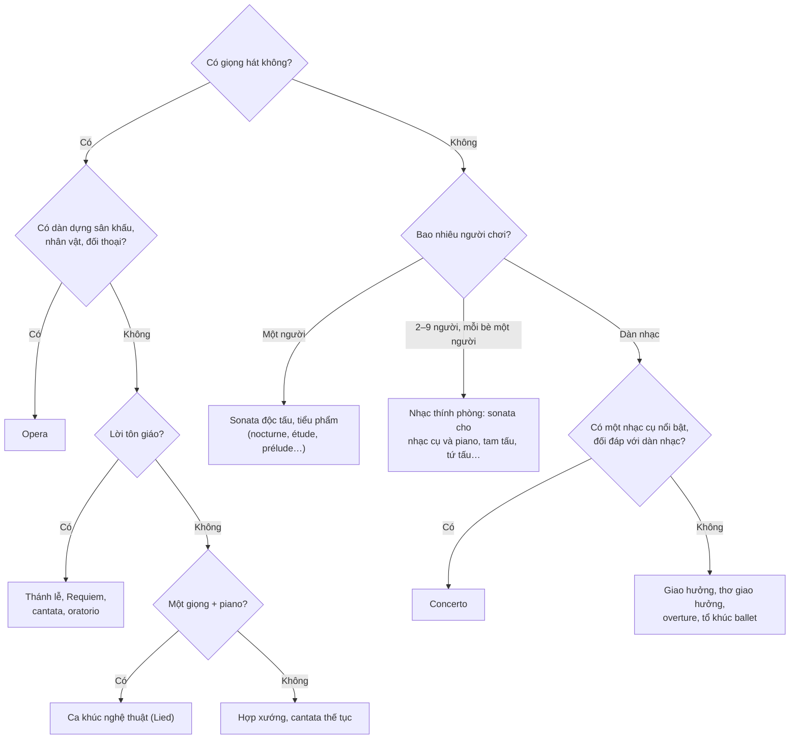

# Nhận diện thể loại qua biên chế

Câu hỏi đầu tiên khi nghe một bản nhạc lạ: **ai đang chơi?** Biết biên chế là bạn đã đoán được thể loại trong phần lớn trường hợp.

## Cây quyết định



## Bảng biên chế thường gặp

| Nghe thấy | Rất có thể là | Ghi chú |
|---|---|---|
| Một piano | Sonata, tiểu phẩm piano | Xem [Các thể loại nhạc piano](../piano/the-loai.md) |
| Một nhạc cụ khác và piano | Sonata cho violin (cello, sáo…) và piano | Hai nhạc cụ ngang hàng |
| Một nhạc cụ không có đệm | Bach cho violin hoặc cello độc tấu; tác phẩm thế kỷ 20 | Ví dụ [Tổ khúc cello](../nghe-nhac/bach-cello-1.md), Debussy *Syrinx* |
| 2 violin, viola, cello | **Tứ tấu đàn dây** | Thể loại thính phòng quan trọng nhất |
| Piano, violin, cello | **Tam tấu piano** | |
| Piano và 4 đàn dây | **Ngũ tấu piano** | Ví dụ [*Con cá hồi*](../nghe-nhac/schubert-ca-hoi.md) (với contrabass) |
| Dàn dây, harpsichord, vài nhạc cụ độc tấu | **Concerto Baroque, concerto grosso** | Xem [Concerto](../hinh-thuc/concerto.md) |
| Dàn nhạc + một piano / violin nổi bật, có cadenza | **Concerto** | |
| Dàn nhạc, 4 chương, khoảng 25–80 phút | **Giao hưởng** | Chương 1 thường ở hình thức sonata |
| Dàn nhạc, một chương, có tiêu đề kể chuyện | **Thơ giao hưởng**, overture | Âm nhạc chương trình |
| Dàn nhạc, nhiều đoạn ngắn nhịp nhảy múa | **Tổ khúc ballet** | Tchaikovsky, Stravinsky |
| Hợp xướng + dàn nhạc + giọng độc xướng, lời Latin | Thánh lễ, **Requiem** | Ví dụ [Mozart *Requiem*](../nghe-nhac/mozart-requiem.md) |
| Một giọng hát + piano, lời tiếng Đức | **Lied** | Ví dụ [*Erlkönig*](../nghe-nhac/schubert-erlkonig.md) |
| Giọng hát + dàn nhạc, kịch tính, tiếng vỗ tay giữa chừng | **Opera** (aria) | Xem [Nhập môn opera](../lich-su/opera.md) |

## Biên chế cũng là manh mối thời kỳ

- **Harpsichord** hoặc **sáo dọc** (recorder) → gần như chắc chắn Baroque (hoặc tái hiện Baroque).
- **Clarinet** hiếm trước khoảng 1780; **tuba** và **cor anglais** nổi bật là dấu hiệu thế kỷ 19.
- **Saxophone** trong dàn nhạc → cuối thế kỷ 19 hoặc thế kỷ 20 (như [*Boléro*](../nghe-nhac/ravel-bolero.md)).
- **Bộ gõ rất nhiều, marimba, vibraphone, piano dùng như nhạc cụ gõ** → thế kỷ 20.
- **Dàn nhạc trên 80 người**, 8 kèn horn → Lãng mạn muộn (Mahler, Strauss) hoặc thế kỷ 20.

```quiz
? Nghe thấy 2 violin, viola và cello, không có gì khác. Thể loại là gì?
+ Tứ tấu đàn dây
- Giao hưởng
- Concerto
> Nhạc thính phòng, mỗi bè một người.
? Dàn nhạc và một piano nổi bật, có đoạn piano chơi một mình khi dàn nhạc dừng. Thể loại là gì?
+ Concerto
- Giao hưởng
- Tam tấu piano
> Đoạn chơi một mình là cadenza.
? Nghe thấy harpsichord trong một bản thu. Thời kỳ có thể nhất là gì?
+ Baroque
- Lãng mạn
- Ấn tượng
> Harpsichord là nhạc cụ phím chính trước khoảng 1750.
```

## Nguồn

- Xem [Dàn nhạc giao hưởng](../nhac-cu/dan-nhac.md), [Hình thức & thể loại](../hinh-thuc/index.md) và [tài liệu tham khảo](../tai-lieu-tham-khao.md).
